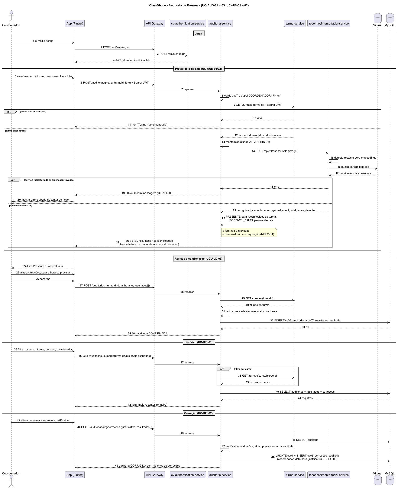

# Class Vision — Auditoria Service

Serviço REST responsável pela auditoria de presença em salas de aula. A aplicação recebe uma foto da sala, consulta o reconhecimento facial, permite a revisão do resultado pelo coordenador e registra a auditoria, o histórico e as correções.

Implementa os casos de uso **UC-AUD-01 a UC-AUD-03** e **UC-HIS-01 e UC-HIS-02**.



## Links

- **Swagger em produção:** <https://auditoria-service-production.up.railway.app/swagger-ui.html>
- **Diagrama editável:** [`docs/diagrama-sequencia-auditoria.puml`](docs/diagrama-sequencia-auditoria.puml)

## Tecnologias

- Java 21
- Spring Boot 4
- Maven
- MySQL

## Pré-requisitos

- JDK 21
- MySQL acessível pela aplicação
- `cv-authentication-service`
- `turma-service`
- `reconhecimento-facial-service`

## Configuração

O deploy de produção é feito automaticamente a cada push na branch `main`. Em produção, as tabelas já estão criadas no MySQL do Railway e a migração abaixo foi aplicada em **16/11/2026**.

Para um banco novo, execute [`docs/ddl-auditoria.sql`](docs/ddl-auditoria.sql). Para atualizar um banco existente, consulte [`docs/migracoes/001-aluno-id-e-correcoes.sql`](docs/migracoes/001-aluno-id-e-correcoes.sql).

Configure as variáveis de ambiente antes de iniciar a aplicação:

| Variável | Obrigatória | Descrição | Padrão |
|---|:---:|---|---|
| `DB_HOST` | Sim | Host do MySQL | — |
| `DB_PORT` | Não | Porta do MySQL | `3306` |
| `DB_NAME` | Sim | Nome do banco | — |
| `DB_USER` | Sim | Usuário do banco | — |
| `DB_PASSWORD` | Sim | Senha do banco | — |
| `JWT_SECRET` | Sim | Mesmo segredo usado pelo `cv-authentication-service` | — |
| `TURMA_SERVICE_URL` | Não | URL base do `turma-service` | `http://localhost:8081` |
| `RECONHECIMENTO_SERVICE_URL` | Não | URL base do serviço de reconhecimento facial | `http://localhost:5000` |
| `PORT` | Não | Porta HTTP da aplicação | `8080` |

> **Atenção:** no Railway, `TURMA_SERVICE_URL` e `RECONHECIMENTO_SERVICE_URL` ainda não estão configuradas. Enquanto esses serviços não estiverem disponíveis, os endpoints de prévia e confirmação retornam `502 Bad Gateway`.

## Como executar

Inicie a aplicação com o Maven Wrapper:

```bash
./mvnw spring-boot:run
```

Após a inicialização:

- API: <http://localhost:8080>
- Swagger UI: <http://localhost:8080/swagger-ui.html>

## Autenticação e autorização

Todos os endpoints exigem um token JWT no cabeçalho:

```http
Authorization: Bearer <token>
```

- Consultas podem ser feitas por qualquer usuário autenticado.
- Operações de escrita exigem as autoridades `COORDENADOR` ou `ADMINISTRADOR`.
- As autoridades são lidas da claim `roles`.
- O identificador do usuário é lido da claim `id` (`usuario_id`).

## Endpoints

| Método | Rota | Descrição |
|---|---|---|
| `POST` | `/auditorias/previa` | Analisa uma foto (`multipart`: `turmaId`, `foto`) e retorna presentes e possíveis faltas sem gravar dados. |
| `POST` | `/auditorias` | Confirma a auditoria revisada e grava a auditoria e seus resultados. |
| `GET` | `/auditorias?cursoId&turmaId&usuarioId&inicio&fim` | Consulta o histórico. As datas usam o formato `yyyy-MM-dd`. |
| `GET` | `/auditorias/{id}` | Consulta os detalhes, resultados e correções de uma auditoria. |
| `POST` | `/auditorias/{id}/correcoes` | Corrige a presença de alunos. A justificativa é obrigatória. |

### Exemplos

#### Gerar prévia

```bash
curl -X POST \
  -H "Authorization: Bearer <token>" \
  -F "turmaId=1" \
  -F "foto=@sala.jpg" \
  http://localhost:8080/auditorias/previa
```

Exemplo de resposta:

```json
{
  "turmaId": 1,
  "data": "2026-11-16",
  "horario": "16:11:44",
  "alunos": [
    {
      "alunoId": 2024020,
      "situacaoPresenca": "PRESENTE",
      "situacaoFace": "RECONHECIDA",
      "confianca": 0.93
    },
    {
      "alunoId": 2024021,
      "situacaoPresenca": "POSSIVEL_FALTA",
      "situacaoFace": null,
      "confianca": null
    }
  ],
  "facesNaoIdentificadas": 1,
  "facesForaDaTurma": 1,
  "totalFaces": 3
}
```

#### Confirmar auditoria

`data` e `horario` são opcionais. Quando omitidos, são definidos com base no horário do servidor.

```bash
curl -X POST \
  -H "Authorization: Bearer <token>" \
  -H "Content-Type: application/json" \
  -d '{
    "turmaId": 1,
    "resultados": [
      {
        "alunoId": 2024020,
        "situacaoPresenca": "PRESENTE",
        "situacaoFace": "RECONHECIDA"
      },
      {
        "alunoId": 2024021,
        "situacaoPresenca": "POSSIVEL_FALTA"
      }
    ]
  }' \
  http://localhost:8080/auditorias
```

#### Corrigir presença

```bash
curl -X POST \
  -H "Authorization: Bearer <token>" \
  -H "Content-Type: application/json" \
  -d '{
    "justificativa": "Aluno chegou atrasado",
    "resultados": [
      {
        "alunoId": 2024021,
        "situacaoPresenca": "PRESENTE"
      }
    ]
  }' \
  http://localhost:8080/auditorias/1/correcoes
```

## Regras de negócio e segurança

- A foto é mantida apenas durante a requisição e nunca é gravada (RSEG-04).
- Apenas alunos com vínculo `ATIVO` na turma são considerados (RN-06).
- Alunos fora da turma ou repetidos são recusados.
- É permitido registrar mais de uma auditoria para a mesma turma no mesmo dia (RN-05).
- Falhas no `turma-service` ou no serviço de reconhecimento retornam `502`, permitindo que o cliente ofereça a opção de tentar novamente (RF-AUD-05).

## Pendências conhecidas

- **Matrícula e `alunoId`:** o reconhecimento facial devolve a matrícula, enquanto a turma utiliza `alunoId`. Até a existência de um serviço de alunos, o `alunoId` vinculado à turma deve ser a própria matrícula numérica.
- **Faces não identificadas:** `auditar-sala` retorna apenas a quantidade, sem o recorte de cada face. A associação de uma face específica a um aluno depende de suporte do serviço de reconhecimento; atualmente, o coordenador faz essa marcação manualmente.
- **Turma inativa (RN-04):** a turma não possui campo de situação. O bloqueio depende de o `turma-service` expor essa informação.
- **Instituição:** o histórico ainda não filtra por `instituicaoId`, mantendo o mesmo comportamento do `turma-service`.

## Testes

Execute a suíte com:

```bash
./mvnw test
```
